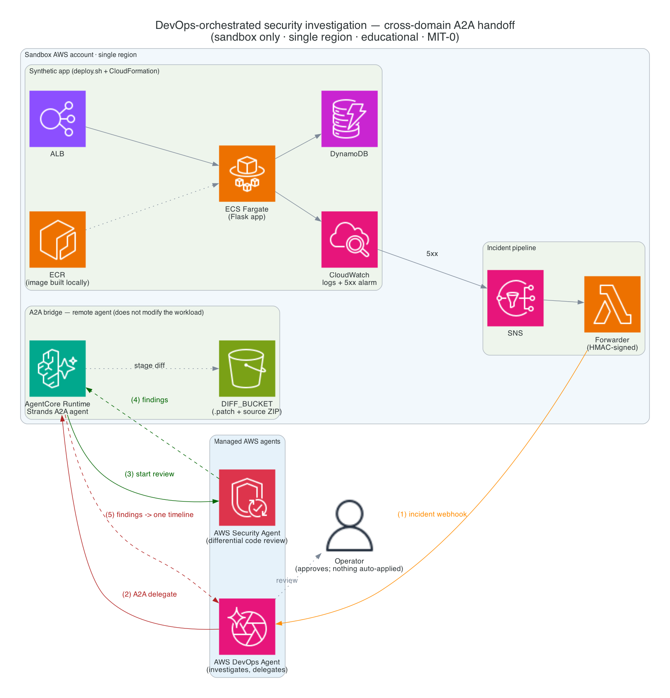

# DevOps-orchestrated security investigation (two managed agents, one incident)

A sandbox sample where **one bad deploy** trips a single incident with two faces
— an operational outage *and* a security regression — and two managed AWS agents
investigate it **together**. The **AWS DevOps Agent** catches the alarm, runs
root-cause analysis, recognizes the cause is a code change, and **delegates a
subtask over the Agent-to-Agent (A2A) protocol** to a custom remote agent that
does not modify your workload. That remote agent drives a real **AWS Security Agent** differential code
review, and the findings fold back into the one DevOps Agent investigation. One
incident, two agents, one timeline — humans approve everything; nothing is
applied automatically.

> ⚠️ **Intentionally vulnerable. Sandbox account only. Single region. Tear down
> after.** This sample plants a security regression on purpose and deploys an
> IAM role, a public ALB, and a running service. It is for education and
> demonstration — **not for production**. Do not run it in a shared or
> production account. See [`SECURITY.md`](SECURITY.md) for the planted-regression
> inventory and [`THREAT-MODEL.md`](THREAT-MODEL.md) for the sandbox guards and
> blast-radius fence.

> ⚠️ **NOT for Production Deployments**
>
> **About `--sandbox-confirmed`:** `deploy.sh` will not run unless you pass
> `--sandbox-confirmed`. Passing it is **your acknowledgment** that you are
> deploying into a disposable sandbox AWS account that you own and use for
> nothing else. The script **cannot verify** that the account is a sandbox, and
> it deploys straight away once the flag is given. Before you run it, confirm
> which account your credentials point to with
> `aws sts get-caller-identity --query Account --output text`, and do not pass
> the flag if you are unsure.

---

## Architecture



The end-to-end flow, validated live:

1. A deliberately-flawed Flask app runs on **ALB → ECS Fargate → DynamoDB** with
   CloudWatch logs and a 5xx alarm. In the healthy build, the sensitive route
   `POST /admin/notes` **fails closed**: the sample provisions no credential for
   it, so every request gets `401`. `app/break-it.sh` deploys a bad revision
   (`BREAK_APP=true`, which forces 5xx on `GET /notes`). The code change that
   "ships" with that deploy — removing the authorization check on
   `POST /admin/notes` — is modeled by
   [`app/changes/dropped-auth.patch`](app/changes/dropped-auth.patch). To keep
   the demo to one image, the patch is **staged for review, not deployed**: the
   running app keeps its auth check, and the Security Agent reviews the patch as
   the change implicated in the incident.
2. The 5xx alarm → **SNS** → a **Lambda forwarder** that HMAC-signs an incident
   and POSTs it to the **AWS DevOps Agent** webhook.
3. The DevOps Agent opens an investigation, does root-cause analysis, and —
   because the root cause is a code/config change — **delegates a subtask over
   the A2A protocol** to a custom remote agent (our bridge).
4. The bridge is a **Strands agent on Amazon Bedrock AgentCore Runtime**. It
   does not modify the workload; its only writes are starting a review job and
   uploading a diff to the review bucket. It calls the real **AWS Security Agent** API: `StartCodeReviewJob`
   (a differential scan of a `.patch` diff staged in the S3 bucket connected to
   the Security Agent Agent Space), `BatchGetCodeReviewJobs` to poll, and
   `ListFindings` to read results.
5. The Security Agent returns findings — an **`AUTHENTICATION_BYPASS`** on
   `POST /admin/notes` (rated HIGH or CRITICAL depending on the run) — which
   fold back into the one DevOps Agent investigation.


## How deployment works (read this first)

**This is not a one-click CloudFormation stack.** The app half *is* a single
CloudFormation stack, but it is deployed by `deploy.sh` — which builds the
container image locally first — and the managed-agent pieces live outside
CloudFormation by necessity. A composed-agents sample has several moving parts:

| Piece | How it's deployed |
|---|---|
| App (ALB, Fargate, DynamoDB, 5xx alarm, SNS, Lambda forwarder) | One CloudFormation stack, `infra/template.yaml`, deployed by `deploy.sh` |
| App container image | **Built locally by `deploy.sh`** (finch or Docker) for `linux/amd64`, pushed to ECR, passed to CloudFormation as the `ImageUri` parameter. The task runs on x86_64 Fargate, so the build is pinned to `--platform linux/amd64` (important on Apple-Silicon Macs). |
| DevOps Agent + Security Agent **Agent Spaces** | Console setup on the managed agents |
| A2A bridge | Amazon Bedrock **AgentCore Runtime**, deployed with the **AgentCore CLI** (see [`a2a-bridge/DEPLOY.md`](a2a-bridge/DEPLOY.md)) |
| Remote-agent registration | Console / IAM step (see [`scripts/register-remote-agent.sh`](scripts/register-remote-agent.sh)) |

---

## Prerequisites

- A disposable **sandbox** AWS account, used for nothing else.
- A **single region** where **both** AWS DevOps Agent and AWS Security Agent
  Agent Spaces are available. Pin everything to this one region — including
  **both Agent Spaces**. The consoles open in whatever region you last used, so
  check the region selector before you create each space.
- **Amazon Bedrock model access** in that region for the model the bridge uses
  (default: Anthropic Claude Sonnet 4.5, via the global cross-Region inference
  profile `global.anthropic.claude-sonnet-4-5-20250929-v1:0`, so inference may
  be served from other regions). Enable it in the Bedrock console under
  **Model access**, or set `BRIDGE_MODEL_ID` on the runtime to another model.
- **AWS CLI v2**, configured for the sandbox account.
- **finch or Docker** — the app image is built locally by `deploy.sh`.
- **Node.js 20+** and the **AgentCore CLI** (`npm install -g @aws/agentcore`),
  plus **`uv`** (`curl -LsSf https://astral.sh/uv/install.sh | sh`) — used to
  deploy the A2A bridge.
- A **DevOps Agent Agent Space** with a generic HMAC webhook configured. Store
  the webhook URL and signing secret in Secrets Manager as
  `<nameprefix>-devops-webhook` (default name prefix: `nimbus`).
- A **Security Agent Agent Space** with **code review enabled**, and an **S3
  bucket you create and connect to that Agent Space** (used as `DIFF_BUCKET`) —
  you upload the app source there and create a code review resource against it.
  Step (c) covers creating and connecting the bucket.

---

## Step-by-step: deploy and run

Every value in `<angle brackets>` is a placeholder — substitute your own and do
**not** paste the brackets. Do not paste real account IDs, resource IDs, or ARNs
into shared places.

> **Seeing `zsh: parse error near '\n'`?** A placeholder was pasted as-is: zsh
> reads `<` and `>` as redirections. Replace the whole `<...>` with the real
> value (quote it if unsure), e.g. `export CODE_REVIEW_ID="cr-1234..."`. If you
> pasted a multi-line block, nothing in that block ran — re-run it.
>
> Run every step in the **same terminal**: later steps read the variables you
> `export` earlier (`REGION`, `SECURITY_AGENT_SPACE_ID`, `CODE_REVIEW_ID`,
> `DIFF_BUCKET`, ...).
>
> **On macOS (zsh), run `setopt interactivecomments` first.** The code blocks
> below have trailing `# comments`; zsh's default treats `#` as part of the
> command when you paste it, which breaks those lines (for example
> `zsh: no matches found` or `not valid in this context`).

> **Finding your resource IDs.** Several steps need IDs for the Agent Spaces and
> the code review (`SECURITY_AGENT_SPACE_ID` like `as-...`, `CODE_REVIEW_ID`
> like `cr-...`, and the DevOps Agent space id). The most reliable source is the
> **console URL**: open the resource in its console and copy the id from the
> address bar (e.g. `.../agent-spaces/as-...`, `.../code-reviews/cr-...`). CLI
> `list` commands exist too, but these are preview-era services whose CLI shapes
> change — if a `list` command errors or returns nothing, use the console URL.

### a. Set your profile and region

```bash
setopt interactivecomments 2>/dev/null || true   # zsh: treat "# ..." as a comment
export AWS_PROFILE=<your-sandbox-profile>
export REGION=us-east-1            # a region where BOTH agents are available
export AWS_REGION=$REGION          # the AgentCore CLI reads AWS_REGION
export NAME_PREFIX=nimbus          # used to name the stack, ECR repo, secret
aws sts get-caller-identity --query Account --output text   # must print your sandbox account
```

### b. Set up the two Agent Spaces and the webhook secret (console + CLI)

Create the **DevOps Agent** and **Security Agent** Agent Spaces in their
respective consoles (see Prerequisites), **both in `$REGION`**. For the DevOps
Agent space, keep the wizard defaults (it creates the IAM roles, adds this
account as the primary account, and enables the Web App). Note each space's id
(from the console URL — see the callout above):

```bash
export AGENT_SPACE_ID=<devops-agent-space-id>
```

Then configure the DevOps Agent's **generic HMAC webhook**: in the DevOps Agent
console, open your Agent Space → **Capabilities** → add a **generic webhook** →
choose **HMAC**. It shows a **webhook URL** and a **signing secret** — copy both
now (the secret is shown only once). Store them in Secrets Manager so `deploy.sh`
can wire the Lambda forwarder to the webhook. This prompts for both values, so
the secret never appears on screen or in your shell history (zsh syntax; in
bash use `read -r -p "Webhook URL: " WEBHOOK_URL` and `read -rs -p ...`):

```bash
read -r "WEBHOOK_URL?Webhook URL: "
read -rs "WEBHOOK_SECRET?Signing secret: "; echo
TMP=$(mktemp); chmod 600 "$TMP"
printf '{"url":"%s","secret":"%s"}' "$WEBHOOK_URL" "$WEBHOOK_SECRET" > "$TMP"
aws secretsmanager create-secret --name "${NAME_PREFIX}-devops-webhook" \
  --secret-string "file://$TMP" --region "$REGION"
rm -f "$TMP"; unset WEBHOOK_SECRET
```

> Re-running? If the secret already exists, replace `create-secret --name` with
> `put-secret-value --secret-id` and keep the rest.

Check that the webhook belongs to a space in `$REGION` — this must print
`event-ai.<your-region>.api.aws`:

```bash
aws secretsmanager get-secret-value --secret-id "${NAME_PREFIX}-devops-webhook" \
  --region "$REGION" --query SecretString --output text \
  | python3 -c 'import json,sys,urllib.parse as u; print(u.urlparse(json.load(sys.stdin)["url"]).netloc)'
```

### c. Set up the Security Agent code review

This has **three distinct sub-steps** — enabling code review is not the same as
creating a code review resource. Do all three:

**c.1 — Create and connect an S3 bucket.** The Security Agent reads code from an
S3 bucket **connected to its Agent Space**; an ordinary bucket does not work
until it is connected.

```bash
aws s3 mb s3://<diff-bucket> --region "$REGION"   # skip if you already have one
```

Then in the Security Agent console: open the Agent Space → **Enable code
review** → **S3 buckets → Add** → enter `<diff-bucket>`. This bucket's name is
your `DIFF_BUCKET`.

**c.2 — Upload the app source as the review's context.**

```bash
rm -f app-source.zip
( cd app && zip -qr ../app-source.zip . -x '__pycache__/*' '.DS_Store' )
aws s3 cp app-source.zip s3://<diff-bucket>/source/ --region "$REGION"
```

**c.3 — Create the code review resource** (this is a separate action from
"enable code review", and it is what produces `CODE_REVIEW_ID`). In the Security
Agent **web app** (open it from the Agent Space → **Web app → Admin access**):
**Code reviews → Create code review** → Title e.g. `nimbus-notes-review` →
**S3 sources** tab → enter `s3://<diff-bucket>/source/app-source.zip` → default
service role → **Create**. Open the created review and copy its id (`cr-...`)
from the console URL.

Capture the three values the bridge needs (see the "Finding your resource IDs"
callout for where each comes from):

```bash
export SECURITY_AGENT_SPACE_ID=<security-agent-space-id>   # as-... (Agent Space URL)
export CODE_REVIEW_ID=<code-review-id>                     # cr-... (code review URL)
export DIFF_BUCKET=<diff-bucket>
```

**c.4 — Stage the review diff.** Put the implicated change where the bridge
will hand it to the Security Agent (`.patch` extension required):

```bash
aws s3 cp app/changes/dropped-auth.patch "s3://$DIFF_BUCKET/diffs/" --region "$REGION"
```

> The bucket must be **connected to the Security Agent Agent Space** (c.1), and
> any diff the Security Agent reviews must be a **`.patch`** file (not `.diff`).

### d. Deploy the app stack

```bash
./deploy.sh --sandbox-confirmed
```

`deploy.sh` refuses to run without the acknowledgment flag. It **builds and
pushes the app image locally** (finch or Docker → ECR), deploys the
CloudFormation stack (app, 5xx alarm, SNS, Lambda forwarder) with the image URI
as a parameter, and prints the **App URL** and the next steps. Set
`CONTAINER_CLI=docker` if you use Docker rather than finch.

### e. Deploy the A2A bridge (AgentCore CLI)

The bridge is **not** deployed by `deploy.sh`. It is a Strands agent on AgentCore
Runtime, deployed with the interactive AgentCore CLI. This is **more than one
command** — the CLI scaffolds its own project and you graft the bridge code and
config into it. [`a2a-bridge/DEPLOY.md`](a2a-bridge/DEPLOY.md) has the full
detail; the sub-steps are:

**e.1 — Scaffold a Strands A2A project** (run one directory outside this repo;
`--name` must be alphanumeric/underscores, no hyphens):

```bash
cd ..
agentcore create --project-name NimbusSecBridge --name nimbus_security_review_agent \
  --language Python --framework Strands --model-provider Bedrock \
  --memory none --build CodeZip --protocol A2A
```

**e.2 + e.3 — Configure the scaffold with one script.** The scaffold needs three
edits: the bridge code as its entrypoint, `boto3` as a dependency, and the
runtime's env vars (`SECURITY_AGENT_SPACE_ID` / `CODE_REVIEW_ID` /
`DIFF_BUCKET`) plus IAM permissions to call the Security Agent.
[`a2a-bridge/configure-bridge.sh`](a2a-bridge/configure-bridge.sh) makes all
three for you. Run it from this repo, in the terminal where you exported the
three values in step c:

```bash
cd sample-devops-orchestrated-security-investigation
./a2a-bridge/configure-bridge.sh ../NimbusSecBridge
```

It should print `1/3`, `2/3` and `3/3` lines and end with "Bridge project
configured". If it says a variable is missing or still looks like a
placeholder, export the real value from step c and re-run; it is safe to run
more than once. (To make the edits by hand instead, see
[`a2a-bridge/DEPLOY.md`](a2a-bridge/DEPLOY.md) steps 2-3.)

> If you skip this step, the bridge still deploys, but every review fails with
> "Security Agent not configured".

**e.4 — Deploy and capture the runtime ARN.** The first command refuses to
deploy unless e.2 + e.3 succeeded, so an unconfigured scaffold is never
deployed:

```bash
grep -q "nimbus-security-bridge" ../NimbusSecBridge/agentcore/cdk/lib/cdk-stack.ts \
  || { echo "Bridge not configured: re-run configure-bridge.sh (step e.2 + e.3) first"; false; } \
  && cd ../NimbusSecBridge \
  && agentcore deploy --yes
agentcore status             # repeat until the agent is deployed (not "Local only")
```

`agentcore deploy --yes` uses the credentials and region in your environment
(`AWS_PROFILE`, `AWS_REGION`). On a fresh account it first CDK-bootstraps the
account (a one-time `CDKToolkit` stack). To preview without deploying, run
`agentcore deploy --dry-run` in `../NimbusSecBridge`; on a fresh account it
reports "AWS environment needs bootstrapping", which is expected.

> **Deployed it before configuring?** Run `configure-bridge.sh` (e.2 + e.3) and
> then e.4 again. The redeploy updates the same runtime, so its ARN does not
> change.

Capture the runtime ARN without copy-pasting it:

```bash
export AGENT_RUNTIME_ARN=$(aws bedrock-agentcore-control list-agent-runtimes \
  --region "$REGION" --output text \
  --query "agentRuntimes[?contains(agentRuntimeName, 'nimbus_security_review_agent')].agentRuntimeArn | [0]")
echo "$AGENT_RUNTIME_ARN"    # must print an arn:aws:bedrock-agentcore:... value, not None
```

> **Redeploying the bridge later?** A new runtime gets a new ARN (and agent
> card URL). Re-run `./scripts/create-sigv4-role.sh`, then remove, deregister,
> and re-register the remote agent (step f) with the new card URL. An
> investigation that still points at an old registration finishes without ever
> delegating to the bridge.

### f. Create the SigV4 role and register the bridge as a remote agent

The DevOps Agent reaches the bridge by assuming an IAM role and signing its A2A
calls with SigV4. Create the role (named `${NAME_PREFIX}-devops-to-bridge`),
then print the registration inputs:

```bash
cd ../sample-devops-orchestrated-security-investigation
./scripts/create-sigv4-role.sh          # needs AGENT_RUNTIME_ARN from e.4
export SIGV4_ROLE_ARN=$(aws iam get-role --role-name "${NAME_PREFIX}-devops-to-bridge" \
  --query Role.Arn --output text)
./scripts/register-remote-agent.sh      # prints the Agent card URL + console steps
```

The role trusts only `aidevops.amazonaws.com` (with `aws:SourceAccount` and
`aws:SourceArn` conditions) and can only call `bedrock-agentcore:GetAgentCard`
and `bedrock-agentcore:InvokeAgentRuntime` on the bridge runtime.

Then, in the DevOps Agent console (in `$REGION`):

1. **Capability Providers → Remote Agent → Register.** Name:
   `<nameprefix>-security-review-agent`. Agent card endpoint: the URL the script
   printed. Authentication: **AWS SigV4** → use an existing role →
   `<nameprefix>-devops-to-bridge`, Region `$REGION`, Service name
   `bedrock-agentcore`. **Next → Register** (the console fetches the agent card
   to validate it).
2. **Your Agent Space → Capabilities → Remote Agents → Add** → select
   `<nameprefix>-security-review-agent`.

If registration fails, [`a2a-bridge/DEPLOY.md`](a2a-bridge/DEPLOY.md) step 6
lists the errors you can hit, in order, with the fix for each. The most common
is `Credential should be scoped to correct service: 'bedrock-agentcore'`, which
means the SigV4 **Service name** field is not exactly `bedrock-agentcore`.

### g. (Optional) Verify the bridge on its own

This checks the bridge → Security Agent half before you involve the DevOps
Agent, so a later failure is easier to place. Skip it if you want to go
straight to the incident.

```bash
cd ../NimbusSecBridge
agentcore invoke --prompt "Start a security review of the staged change for the nimbus-notes service."
```

The bridge starts a Security Agent review of the staged patch (c.4) and then
keeps waiting for it to finish, so the command shows "Invoking Agent" for the
whole review — typically 10-15 minutes. The CLI may give up first and print
`A2A invoke failed`; the review keeps running. Check it directly:

```bash
aws securityagent list-code-review-jobs-for-code-review --region "$REGION" \
  --agent-space-id "$SECURITY_AGENT_SPACE_ID" --code-review-id "$CODE_REVIEW_ID" \
  --query 'codeReviewJobSummaries[].[codeReviewJobId,status,createdAt]' --output text
```

When the newest job is `COMPLETED`, list its findings (expect an
`AUTHENTICATION_BYPASS` on `POST /admin/notes`):

```bash
aws securityagent list-findings --region "$REGION" \
  --agent-space-id "$SECURITY_AGENT_SPACE_ID" --code-review-job-id <cj-...> \
  --query 'findingsSummaries[].[riskLevel,riskType,name]' --output text
```

> The bridge's CloudWatch logs show repeated `Failed to export span batch code:
> 400` errors. They come from the scaffold's OpenTelemetry tracing (it needs
> CloudWatch Transaction Search enabled in the account) and do not affect the
> bridge.

### h. Trip the incident

One command deploys the bad revision, waits for it to roll out, and generates
the 5xx traffic that fires the alarm (alarm → SNS → forwarder → DevOps Agent
webhook → investigation):

```bash
cd ../sample-devops-orchestrated-security-investigation
./app/break-it.sh
```

It takes about 5-8 minutes. When it ends with "Alarm is in ALARM", the
investigation appears in the operator app within about a minute.

If your network **cannot reach the ALB** (VPN or egress blocks), no traffic
arrives and the alarm cannot fire. `break-it.sh` detects this and, if
`AGENT_SPACE_ID` is set (step b), starts the investigation directly with
[`aws devops-agent create-backlog-task`](https://docs.aws.amazon.com/cli/latest/reference/devops-agent/create-backlog-task.html)
instead. In that case the DevOps Agent still finds the bad deploy and delegates
the security review, but it reports that the ALB saw no traffic.

To always start the investigation directly (in addition to the alarm), run
`INVESTIGATE=always ./app/break-it.sh`.

**Can't reach the ALB but still want to test the alarm path?** Deploy the bad
revision without the fallback, then force the alarm. This runs the real alarm
action, so SNS (with its KMS key), the forwarder, and the DevOps Agent webhook
are all exercised:

```bash
INVESTIGATE=never ./app/break-it.sh      # wait for "Bad revision is live"
aws cloudwatch set-alarm-state --region "$REGION" --alarm-name "${NAME_PREFIX}-target-5xx" \
  --state-value ALARM --state-reason "Manual test of the alarm -> webhook path"
aws logs tail "/aws/lambda/${NAME_PREFIX}-forwarder" --region "$REGION" --since 10m
```

The forwarder log should show `Posted incident ... -> 200` within a minute or
two, and an investigation then starts on its own. Because no real 5xx traffic
reached the ALB, the investigation finds the bad deploy but no matching error
spike. Alternatively, send real traffic from another network (for example a
phone on mobile data) by loading `<app-url>/notes` about ten times in a minute.

### i. Watch the handoff

Open the DevOps Agent operator app. The investigation runs root-cause analysis
(it finds the task-definition revision with `BREAK_APP=true`), **delegates to
the bridge over A2A**, the Security Agent review runs (10-15 minutes), and the
**`AUTHENTICATION_BYPASS` finding on `POST /admin/notes` folds into the one
timeline**. Humans approve everything; nothing is applied automatically. When
done, revert the app:

```bash
./app/fix-it.sh
```

---

## Repository layout

```
.
├── README.md                      # this file
├── SECURITY.md                    # planted-regression inventory; how to report real issues
├── THREAT-MODEL.md                # sandbox guards, blast-radius fence, teardown guarantees
├── CONTRIBUTING.md                # how to contribute; security issue notifications
├── CODE_OF_CONDUCT.md             # Amazon Open Source Code of Conduct
├── LICENSE                        # MIT-0
├── deploy.sh                      # build image locally, push to ECR, deploy the stack
├── teardown.sh                    # delete the stack and app image; prints manual removals
├── docs/
│   ├── architecture.png           # the architecture diagram embedded above
│   └── architecture_diagram.py    # regenerates the diagram from the official AWS icons
├── app/                           # the deliberately-flawed Flask app
│   ├── app.py                     # ALB→Fargate→DynamoDB service; the vulnerable route
│   ├── Dockerfile                 # image built locally by deploy.sh
│   ├── requirements.txt           # app dependencies
│   ├── break-it.sh                # deploy the bad revision, generate 5xx traffic (or start the investigation)
│   ├── fix-it.sh                  # revert to the healthy revision
│   ├── _set_break_env.py          # helper: flips BREAK_APP on the task definition
│   └── changes/
│       └── dropped-auth.patch     # the diff the Security Agent reviews
├── forwarder/
│   └── forwarder.py               # SNS→Lambda: HMAC-sign and POST the incident to the webhook
├── infra/
│   └── template.yaml              # the app CloudFormation stack
├── a2a-bridge/                    # the remote agent (novel core)
│   ├── bridge.py                  # Strands agent; drives the Security Agent API
│   ├── configure-bridge.sh        # applies the bridge code, boto3, env vars + IAM to the AgentCore scaffold
│   ├── requirements.txt           # bridge dependencies
│   ├── Dockerfile                 # reference only; AgentCore CLI builds the runtime
│   ├── agent_card.reference.json  # reference agent card
│   └── DEPLOY.md                  # full AgentCore CLI deployment steps
└── scripts/
    ├── create-sigv4-role.sh       # creates the IAM role the DevOps Agent uses to call the bridge
    ├── register-remote-agent.sh   # prints the agent card URL + remote-agent registration steps
    └── lint-repo.sh               # repo lint checks
```

---

## Tear down

This sample creates resources across CloudFormation, ECR, AgentCore, IAM,
Secrets Manager, S3, and the two managed Agent Spaces. Removing everything is a
mix of scripted and manual steps — **work through the full checklist below** so
nothing is left running (and billing) in your account.

### Step 1 — Scripted removal

First, in the DevOps Agent console, remove `<nameprefix>-security-review-agent`
from your Agent Space (**Capabilities → Remote Agents → Remove**) and deregister
it (**Capability Providers → select it → Actions → Deregister**), so nothing
tries to call the bridge while it is being deleted.

```bash
# Look up the bridge runtime id (the part of the ARN after "runtime/").
export BRIDGE_RUNTIME_ID=$(aws bedrock-agentcore-control list-agent-runtimes --region "$REGION" \
  --output text --query "agentRuntimes[?contains(agentRuntimeName, 'nimbus_security_review_agent')].agentRuntimeId | [0]")
echo "$BRIDGE_RUNTIME_ID"

# Deletes: the app CloudFormation stack (VPC, subnets, ALB, ECS Fargate service +
# cluster, DynamoDB table, 4 VPC endpoints, SNS topic + its KMS key, Lambda
# forwarder, CloudWatch alarm + log group, 3 stack IAM roles), the app ECR
# repository, every task-definition revision (including the one break-it.sh
# registered), the forwarder log group, the bridge runtime + its log group, and
# the AgentCore CLI's stack. The KMS key enters a 7-day pending-deletion window.
BRIDGE_STACK=AgentCore-NimbusSecBridge-default ./teardown.sh
```

The AgentCore CLI has no `destroy` command, which is why `teardown.sh` deletes
the runtime through the control-plane API and then deletes the CLI's
`AgentCore-<project>-default` stack. If you used a different `--project-name`,
change `BRIDGE_STACK` to match.

### Step 2 — Manual removal (what the scripts do NOT delete)

These are created outside the stack (by you, by `deploy.sh`, by the AgentCore
CLI, or in a console) and must be removed by hand. Use your own names/region.

```bash
# a. The DevOps Agent webhook secret (Secrets Manager).
aws secretsmanager delete-secret \
  --secret-id "${NAME_PREFIX}-devops-webhook" \
  --force-delete-without-recovery --region "$REGION"

# b. The SigV4 role + inline policy created for remote-agent registration (step f).
aws iam delete-role-policy \
  --role-name "${NAME_PREFIX}-devops-to-bridge" --policy-name invoke-bridge
aws iam delete-role --role-name "${NAME_PREFIX}-devops-to-bridge"

# c. The objects you uploaded to the Security Agent S3 bucket (diffs + source).
aws s3 rm s3://<diff-bucket>/diffs/  --recursive --region "$REGION"
aws s3 rm s3://<diff-bucket>/source/ --recursive --region "$REGION"

# d. The DIFF_BUCKET itself — ONLY if you created it for this sample.
#    (Disconnect it from the Security Agent Agent Space in the console first.)
aws s3 rb s3://<diff-bucket> --force --region "$REGION"

# e. The CDK bootstrap — ONLY if `agentcore deploy` bootstrapped this account
#    (step e.4) and nothing else here uses CDK. Its assets bucket is versioned
#    and retained, so empty and remove it after deleting the stack.
CDK_BUCKET=cdk-hnb659fds-assets-$(aws sts get-caller-identity --query Account --output text)-$REGION
aws cloudformation delete-stack --stack-name CDKToolkit --region "$REGION"
aws cloudformation wait stack-delete-complete --stack-name CDKToolkit --region "$REGION"
aws ecr delete-repository --force --region "$REGION" \
  --repository-name "${CDK_BUCKET/assets/container-assets}" >/dev/null 2>&1 || true
for kind in Versions DeleteMarkers; do
  aws s3api delete-objects --bucket "$CDK_BUCKET" --region "$REGION" --delete "$(aws s3api \
    list-object-versions --bucket "$CDK_BUCKET" --region "$REGION" --output json \
    --query "{Objects: $kind[].{Key:Key,VersionId:VersionId}}")" >/dev/null 2>&1 || true
done
aws s3 rb "s3://$CDK_BUCKET" --region "$REGION" \
  || echo "(if this fails, empty $CDK_BUCKET in the S3 console, then delete it)"
```

### Step 3 — Console removals (no CLI)

- **Deregister the remote agent** in the DevOps Agent console: Capability
  Providers → select `${NAME_PREFIX}-security-review-agent` → **Deregister**
  (detach it from the Agent Space first if prompted).
- **Delete the DevOps Agent Agent Space** — if you created it only for this
  sample. The wizard also created two IAM roles per space
  (`DevOpsAgentRole-AgentSpace-*` and `DevOpsAgentRole-WebappAdmin-*`); delete
  them in the IAM console after the space is gone.
- **Delete the Security Agent Agent Space** (including the code review resource)
  — if you created it only for this sample.
- Check the **other regions** in both consoles for any Agent Space you created
  by accident while the console was pointed elsewhere.

### Step 4 — Local cleanup (no cost, just tidy)

- Delete the AgentCore bridge project folder you scaffolded in step (e)
  (e.g. `~/Downloads/NimbusSecBridge`) — only after the bridge runtime and its
  `AgentCore-<project>-default` stack are deleted (Step 1), since you read the
  runtime id and stack name from `agentcore status` in that project.
- Delete the local `app-source.zip` if you created one.

> **Verify nothing is left billing.** After the above, confirm the stack is gone
> (`aws cloudformation describe-stacks --stack-name devops-security-composition
> --region "$REGION"` should return "does not exist"), and check the ECS, ALB,
> and AgentCore consoles show no running resources from this sample.

---

## Security

This sample is intentionally vulnerable for demonstration. See:

- [`SECURITY.md`](SECURITY.md) — the planted-regression inventory and how to
  report a genuine (non-intentional) issue.
- [`THREAT-MODEL.md`](THREAT-MODEL.md) — the sandbox guards, blast-radius fence,
  and teardown guarantees.
- [`CONTRIBUTING.md`](CONTRIBUTING.md#security-issue-notifications) — how to
  report a potential security issue in this sample.

### Plain HTTP is for the sandbox demo only

The load balancer listens on plain HTTP (port 80) and `AppUrl` is an
`http://` URL. Nothing sensitive crosses it: the app serves synthetic notes,
and no credential is provisioned for its one write route. Traffic is not
encrypted in transit, so **do not reuse this listener pattern for a real
workload.** Before you adapt the template, move the load balancer to HTTPS:

1. Request or import a certificate in AWS Certificate Manager for a domain you
   own, and point that domain at the load balancer.
2. Add an HTTPS listener on port 443 that uses the certificate and a current
   TLS security policy (TLS 1.2 or later), forwarding to the same target group.
3. Change the port 80 listener to redirect to HTTPS, and allow port 443 in
   `AlbSg`.
4. Use the `https://` domain URL wherever the scripts read `AppUrl`.

See [Create an HTTPS listener for your Application Load Balancer](https://docs.aws.amazon.com/elasticloadbalancing/latest/application/create-https-listener.html).

## Responsible AI

This sample uses generative AI in two places: the managed AWS DevOps Agent and
AWS Security Agent, and the A2A bridge, which runs an Anthropic Claude model
through **Amazon Bedrock** (default `global.anthropic.claude-sonnet-4-5-20250929-v1:0`,
set with `BRIDGE_MODEL_ID`). Keep these points in mind if you adapt it:

- **Humans stay in the loop.** Both agents only investigate and propose. Nothing
  the agents conclude is applied automatically: rollbacks (`./app/fix-it.sh`)
  and code fixes are human decisions.
- **Treat AI output as advisory.** Investigation summaries and security
  findings can be incomplete or wrong. Verify a finding against the code and
  the AWS Security Agent console before acting on it, and do not use the
  agents' output as the sole basis for production or security decisions.
- **Treat investigated content as untrusted.** Logs, diffs, and incident text
  can contain prompt-injection attempts. The bridge's system prompt treats all
  input as untrusted data, and its tools can only start a review and read
  findings, which bounds what a manipulated model could do. See
  [`THREAT-MODEL.md`](THREAT-MODEL.md).
- **Add guardrails for your own content.** The sample processes only synthetic
  data, so it does not configure [Amazon Bedrock Guardrails](https://docs.aws.amazon.com/bedrock/latest/userguide/guardrails.html).
  If you point the bridge at real code or incidents, create a guardrail (for
  example, sensitive-information filters for credentials and personal data,
  plus a prompt-attack filter) and apply it to the bridge's model invocations.
- **Data location.** The default model ID is a global cross-Region inference
  profile, so prompts and responses may be processed outside your deployment
  Region. Use a geographic profile (for example `us.`) through
  `BRIDGE_MODEL_ID` if you need inference kept in one geography.
- **Data handling.** No customer data, personal data, or secrets are sent to the
  model by the sample: it reviews the synthetic `dropped-auth.patch` and the
  sample's own source.

## License

This library is licensed under the MIT-0 License. See the [LICENSE](LICENSE) file.
